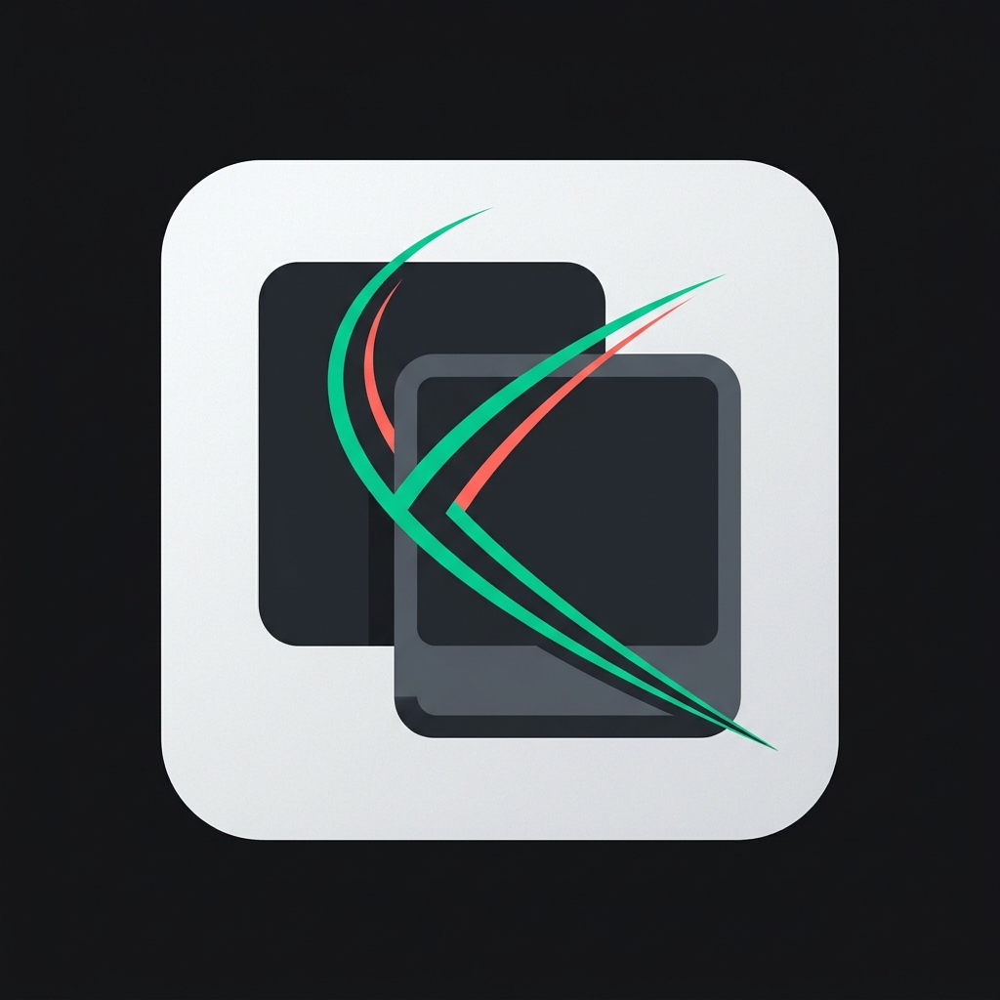

# SwipeVault

<p align="center">
  <strong>Swipe. Sort. Declutter.</strong><br/>
  A smarter, gesture-based way to clean up your Android gallery.
</p>

<p align="center">
  
</p>

<p align="center">
  <em>Your photos. Your decisions. Your control.</em>
</p>

---

## About

**SwipeVault** is a modern Android photo management and gallery-cleaning application that makes decluttering your camera roll simple and intuitive.

Instead of manually selecting hundreds of photographs, SwipeVault lets you review your gallery one photo at a time using familiar swipe gestures.

Keep the photos you love, queue unwanted ones for deletion, and track your cleaning progress — all through a clean, gesture-driven interface.

## Features

- **Gesture-based photo review** – Swipe through your gallery one photo at a time.
- **Keep photos** – Swipe right to keep a photo.
- **Deletion queue** – Swipe left to queue a photo for deletion.
- **Skip photos** – Swipe up to skip a photo without making a decision.
- **Album management** – Browse and organize your review sessions by gallery album.
- **Safe deletion workflow** – Review queued photos and use Android's system confirmation before deletion.
- **Storage insights** – View photo storage information and estimated space recovery.
- **Cleaning statistics** – Track reviewed, kept, queued and deleted photos.
- **Review history** – Keep track of previous cleaning sessions.

## How It Works

| Gesture | Action |
|---|---|
| Swipe Right | Keep photo |
| Swipe Left | Add to deletion queue |
| Swipe Up | Skip photo |

SwipeVault separates the decision to delete a photo from the actual deletion process. Photos added to the deletion queue are reviewed before the Android system is asked to confirm deletion.

**Nothing should be permanently deleted merely because you swiped left.**

## Screenshots

<!-- Add your actual application screenshots here. -->

<p align="center">
  
  
  
  
</p>

## Tech Stack

| Technology | Purpose |
|---|---|
| Kotlin | Primary programming language |
| Jetpack Compose | Modern declarative UI |
| Material 3 | UI components and styling |
| Room | Local database |
| Android MediaStore | Gallery and media access |
| Coil | Image loading |
| Kotlin Coroutines | Asynchronous operations |
| AndroidX Navigation | App navigation |
| Gradle Kotlin DSL | Build configuration |

## Requirements

- Android Studio
- Android SDK
- JDK 11 or compatible configured Android Gradle JDK
- Android device or emulator running Android 7.0 (API 24) or later

## Getting Started

### 1. Clone the repository

```bash
git clone https://github.com/cainy-strange/Swipe-Vault.git
```

### 2. Open the project

1. Launch Android Studio.
2. Select **Open**.
3. Choose the cloned `Swipe-Vault` directory.
4. Allow Gradle to synchronize the project.

### 3. Configure local environment

The project includes an `.env.example` file.

Copy it to `.env` if your local build requires environment-specific secrets:

```bash
cp .env.example .env
```

Do not commit `.env`, signing credentials, or private keys.

### 4. Run the application

Connect an Android device with USB debugging enabled, or launch an emulator.

Select the `app` run configuration in Android Studio and press **Run**.

> Note: Release signing configuration may need to be adjusted for your own signing key. Never publish private signing credentials.

## Project Structure

```text
Swipe-Vault/
├── app/
│   ├── src/main/
│   │   ├── java/com/example/
│   │   │   ├── data/
│   │   │   │   ├── local/
│   │   │   │   ├── media/
│   │   │   │   └── repository/
│   │   │   ├── domain/
│   │   │   ├── ui/
│   │   │   │   ├── components/
│   │   │   │   ├── navigation/
│   │   │   │   ├── screens/
│   │   │   │   └── viewmodel/
│   │   │   └── util/
│   │   └── res/
│   ├── build.gradle.kts
│   └── proguard-rules.pro
├── gradle/
├── build.gradle.kts
├── gradle.properties
├── settings.gradle.kts
├── .env.example
└── README.md
```

## Privacy

SwipeVault is designed around direct management of the media stored in your Android gallery.

- Gallery access is governed by Android permissions.
- Media operations use Android MediaStore.
- Deletion requests use Android's system confirmation workflow on supported versions.
- No internet permission is declared in the current Android manifest.

Review the source code and backup configuration before relying on any privacy or data-retention guarantees.

## Contributing

Contributions, suggestions and bug reports are welcome.

If you would like to contribute:

1. Fork the repository.
2. Create a feature branch.
3. Make your changes.
4. Test your changes.
5. Submit a pull request describing your improvements.

For major changes, please open an issue first to discuss the proposed modification.

## Roadmap

Potential future improvements:

- [ ] Improved duplicate-photo detection
- [ ] Additional filtering and sorting options
- [ ] More detailed storage analytics
- [ ] Enhanced photo review controls
- [ ] Accessibility improvements
- [ ] Expanded automated test coverage

## License

A license has not yet been selected for this repository.

See the repository's license information once a license is added.

---

<p align="center">
  Made with care for a cleaner camera roll.
</p>

<p align="center">
  <strong>SwipeVault</strong> · Open-source Android photo management
</p>